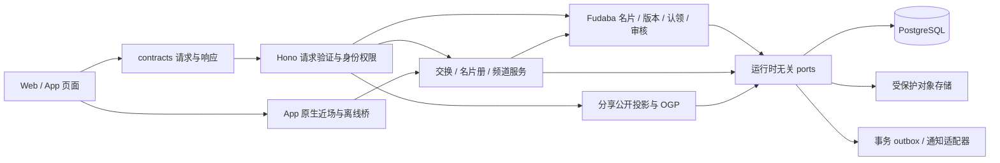
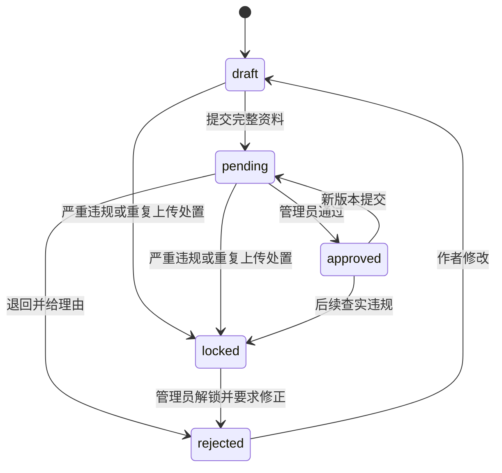
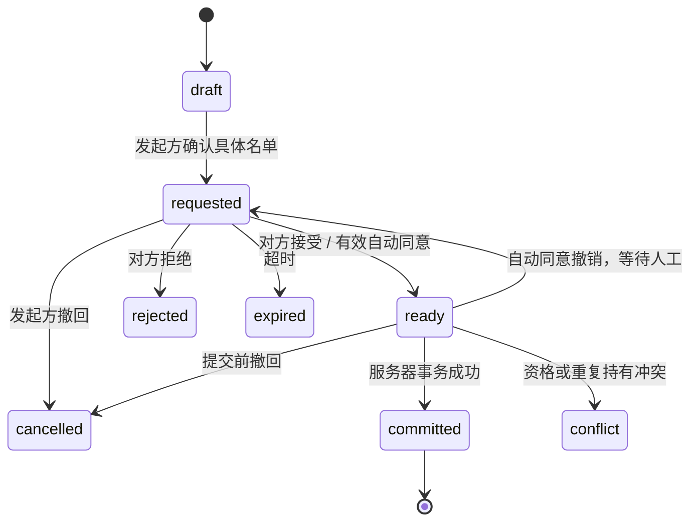

# 名片交换拓展：系统设计评审稿

> 类型：任务系统设计
> 状态：Draft，待产品评审；未授权实施
> 权威来源：[原始需求与验收](./prd.md)、[现状研究](./research/current-capabilities.md)、[分享衔接](./research/sharing-integration.md)、[平台矩阵](./research/native-capability-matrix.md)、[近场与权限研究](./research/proximity-exchange-and-permissions.md)及各 workspace `.rules`

## 1. 目标与方案边界

本设计覆盖 NC-01 至 NC-34 的完整生命周期，包括上传、审核、认领、分享、收录、线上交换、现场交换、临时频道、静默交换、特殊展示与创作标签池。每项能力安排在明确阶段；平台无法可靠支持的行为保留研究结论和可用的替代流程，不承诺跨端后台必达。

领域继续以 Fudaba 名片为业务实体。旧 `Namecard` 不作为新的交换对象，也不建立第二套名片主表。已有社交分享任务负责公开分享基座，本方案负责交换、收录与权限扩展的接入契约。当前规划不修改其暂缓实施的范围。

本文件中的新增表、接口、开关、插件和参数均为设计建议。当前实现以 research 的源码锚点为准；产品建议的确认状态见第 18 节。

### 1.1 当前实现与必须改变的行为

| 当前证据 | 拓展影响 |
| --- | --- |
| `fudaba_cards` 已统一 registered/guest/legacy 来源；`card_number` 是数字兼容标识；历史 `cards` 仍被认领流程读取 | 新交易统一解析 canonical string cardId，不能把数字与字符串 ID 当两张卡；保留必要迁移来源表，不重新建设旧名片分享适配。 |
| 注册上传必须正背两图，每张 8 MiB；墙上传走 guest route，每张 3 MiB，即使登录也不自动绑定 | 新统一上传入口使用登录账号；至少正面、背面可选和新上限是行为变更，不是 UI 文案调整。历史 guest token 状态读取保留独立权限。 |
| 当前编辑覆盖行并退回 pending，旧图在替换/删除后清理 | 快照和引用保留先落地；之后才能满足解绑不删除他人收藏和审核前后对比。 |
| `favorite` 无对方授权，读当前公开卡，按卡创建时间排；隐藏或删除会失去公开读取资格 | 不能把 favorite 直接命名成已交换名片册；保留互动数据并新增持有账本。 |
| 有 office-bound exchange request 表与 port，但没有已挂载的完成/双确认/名片册写入流程 | 复用数据基础时必须处理 office FK、单卡字段、终态 trigger 和 owner FK；数据库 accepted 行不能自动转成已完成收藏。 |
| 当前 publication 混合 hidden，`available` 表示交换意愿；`approving` 是审核并发冻结 | 拆分状态迁移；不得把 available 当私有，或把 approving 当违规锁定。 |
| Wiki 选择器包含非偶像条目；page kind/group 不证明产品担当资格 | 新允许清单与真实组合关系是必要能力，不能只复用现有搜索结果。 |
| 注册卡与数字兼容墙/图片的公开资格条件不同，未绑定历史卡没有认领截止 | 统一 wall/search/count/JSON/HTML/media 的资格入口，保留各来源映射并补截止政策。 |
| 账号注销尚未实施，旧架构文案曾建议注销后保留公开内容 | 本轮用户已明确注销解绑和认领截止；实施时同步更新账号生命周期权威文档，不能沿用旧提案。 |
| Tauri 已有其他插件，没有 BLE/NFC 原生插件或权限 | 接入是 owned plugin 专项，不把现有 WebView invoke 或地理定位当近场能力。 |

各项证据和测试锚点在 [current-capabilities.md](./research/current-capabilities.md) 与 [source-map.md](./research/source-map.md)。本轮读取了测试，没有运行交换产品验证。

## 2. 分层与能力归属

- API 的新能力放在现有 Fudaba domain 及其 capabilities 内，调用 runtime-neutral repository/media/notification ports。旧名片 `namecards` domain 继续承担自己的既有兼容职责，不由新交换服务依赖其 handlers。
- ExchangeService 负责资格、双方授权、幂等和事务。CollectionService 负责收录列表、排序筛选和收藏者侧隐藏。RoomService 负责临时频道与成对交换编排；这些可以先是同一领域内的 capability，不拆独立部署服务。
- Wiki 提供角色、企划和组合事实；交换领域拥有「可以作为名片担当」的资格政策。Platform 负责账号身份与注销生命周期；审核继续走 Backoffice 权限。
- PostgreSQL 是交换与收录的最终依据。Valkey 可加速房间发现、限流或事件分发，任何缓存丢失都不改变交易结果；超时回退遵守既有 bounded-cache 契约。
- contracts 拥有每个 HTTP JSON 请求、成功与错误。multipart carrier、数据库记录和原生对象由各自应用拥有。页面只通过 `app/lib/api` facade 调用接口。

## 3. 领域模型

### 3.1 名片、版本与归属

稳定的 `cardId` 标识一张名片，重审或资料纠错不改变它。建议在现有 Fudaba 实体上增量增加以下概念，实施时保留现有 `revision` 的并发控制语义，另用 `contentRevisionId` 标识内容快照。

| 概念 | 建议字段或关联 | 用途 |
| --- | --- | --- |
| Card | cardId、uploadedAt、originalUploaderId、ownerAccountId、bindingState、visibility、ownerSortOrder | 归属、发布和本人排列；制作人名字不充当账号身份。 |
| CardRevision | contentRevisionId、cardId、makerName、makerReading、introduction、aiGenerated、contentHash、createdAt、moderationState | 不可变的提交资料与审核版本。 |
| CardTarget | revisionId、kind=project/character/other、projectId/characterId、otherLabel | 企划担当、角色担当和待补充角色；组合不作为持久化担当。 |
| Credit | revisionId、role=designer/illustrator、displayName、linkedAccountId 或 externalUrl | 创作署名；账号关联可失效但署名快照保留。 |
| Affiliation | revisionId、displayText、normalizedFilterKey | 象征性的团体署名与筛选，不赋予社团管理权。 |
| CardAsset | revisionId、pageId、role=front/back/inner、objectId、sortIndex、rotation、width、height | 正面必有，背面可选，多页排序和旋转。 |
| CardEffectLayer | revisionId、pageId、effectPreset、alphaObjectId、parametersVersion | 可选工艺效果；只允许受控图层和预设参数。 |
| ModerationDecision | revisionId、actor、decision、reasonCode、reasonText、beforeRevisionId、decidedAt | 审核差异、退回、锁定及申诉审计。 |
| BindingEvent / ClaimRequest | cardId、previousOwner、claimant、evidenceRef、decision、timestamp | 历史认领、解绑和注销留痕。 |

`originalUploaderId` 记录上传来源，不因解绑被覆盖；来源账号注销后移除可识别关联并保留必要业务来源类型。`ownerAccountId` 仅通过默认上传绑定、审核通过的认领和注销/本人解绑变更；普通编辑请求没有改 owner 的字段。

### 3.2 名片册与交换

| 概念 | 建议字段或关联 | 约束 |
| --- | --- | --- |
| CollectionEntry | holderAccountId、cardId、acquiredRevisionId、displayRevisionId、sourceExchangeId、acquiredAt、hiddenAt | 唯一 `(holderAccountId, cardId)`；获得版本/时间/回执不可变，展示版本可由持有者显式更新。 |
| ExchangeRequest | exchangeId、kind=collect/mutual/room-fill、initiator、recipient、state、expiresAt、requestHash | 单向收录、双向交换和授权频道补齐共用交易核心，各自明确方向约束。 |
| ExchangeItem | exchangeId、fromAccount、toAccount、cardId、approvedRevisionId、offerDigest | 固定方向与版本，禁止客户端自由指向任意 owner。 |
| ParticipantConsent | exchangeId、accountId、offerDigest、consentedAt、source | 记录每一方对这份具体名单的授权。 |
| ExchangeCommit | exchangeId、committedAt、outcome、serverReceipt | 与全部 CollectionEntry 在同一事务落地。 |
| UserPreference | accountId、requestPolicy、autoPolicyRevision、quickCardIds、quickGroupRevision、silentEnabled、silentPolicyRevision | 人工审批为默认；快速组选卡不代表常驻自动同意；不同授权来源单独撤销。 |
| Encounter / DeviceCertificate | encounterId、deviceId、certificateId、offerDigest、signatures、expiresAt | App 近场离线补偿所需的有限期设备凭据。 |
| Room / Membership / Batch | roomId、joinCodeHash、joinTokenHash、expiresAt、memberState、consentSnapshotHash | 临时会面、成员确认和成对交易调度。 |

点赞、emoji、旧收藏标记与 CollectionEntry 保持独立。没有双方授权或收录授权的互动数据不能回填成交换记录。

### 3.3 快照建议及保留范围

建议名片册保存交换时获批的内容快照，显示该版本的图、担当和署名。原作者修改资料后，新申请使用新获批版本；旧收藏提供「作者已有新版」提示，更新必须由收藏者选择，不创建第二个 CollectionEntry。

建议 `acquiredRevisionId` 和 sourceExchangeId 永远保留原始获得事实，`displayRevisionId` 初始等于 acquiredRevisionId，更新只改展示指针。更新要求最新版本当前获批、绑定且对该收藏者可公开访问；作者隐藏、解绑或安全封禁后不能凭旧持有权读取新版本。本期隐藏卡不提供新版更新授权捷径，仍可正常读取当时合法获得的版本；尚未持有该卡的新接收者可经作者单次授权取得具体获批版本。

GC 同时保留原始获得与当前展示版本；被替换的中间展示版本如果没有其他引用，可按版本保留政策清理字节。原始获得版本不能因用户点更新就释放。可选替代是仅保留原始获得事实而释放旧媒体，或完全不提供更新；前者不能再承诺随时查看获得时的图片，二者必须在 D-01 明确选择。

解绑、认领期结束和账号注销不能删除已有 CollectionEntry 或其可合法展示的快照。若管理方必须封禁 NSFW、侮辱现实人物或其他违规内容，单独的安全封禁状态可让所有读取返回占位说明，保留获得时间与交换事实，不能让图片因「已交换」绕过封禁。此处区分用户删除和安全处置；这是待产品确认的 D-01 建议。

对象 GC 以当前版本、审核保留版本、收藏快照和审计引用共同计算存活引用。锁定保留期结束后，只有无上述引用的内容才可清理；安全封禁内容可按独立保留策略清除字节并保留最小交易墓碑。不能把「删除当前卡片」直接接到图片删除队列。

## 4. 状态与资格

### 4.1 使用独立状态轴

用户提案中的「待认领」属于归属状态，其余审核状态属于内容审核；拆开保存，UI 按优先级组合展示。

| 状态轴 | 状态 | 说明 |
| --- | --- | --- |
| 绑定 | unclaimed / bound / unbound | 历史待认领、正常绑定、主动解绑或注销。 |
| 内容审核 | draft / pending / approved / rejected / locked | 草稿、待审核、通过、退回、禁止编辑；通过状态是正常交换所需状态。 |
| 本人显示 | visible / hidden | 控制名片墙、本人以外主页和公开分享，不等于收藏者侧隐藏。 |
| 整卡操作锁 | unlocked / locked | 管理员锁定阻止新草稿、编辑、交换和公开派发；与版本退回及安全止读分别保存。 |
| 安全处置 | available / blocked | 违规全局止读；禁止被普通隐藏/解绑逻辑绕过。 |
| 收藏者显示 | visible / hidden | 只控制该用户的名片册列表，不改作者名片状态。 |

图表示待审核版本的状态变化，不能用它覆盖已获批快照。待审新版与 `publishedRevisionId` 同时存在；建议保留旧获批版本的发布资格直至新版本通过，作者可随时隐藏。所有新提交都需审核；细微改动只帮助管理员快速判断，没有未经授权的自动发布分支。

管理员选择 locked 必须在同一事务设置整卡操作锁，不能只锁新版而让旧版继续交换或另建草稿。重复上传等不需要全局安全止读的锁定仍停止公开展示和新交换，已有合法收藏可见；NSFW 等安全封禁另将 safety=blocked，已有收藏只显示占位。解锁需要管理员理由和审计，再按指定版本状态复审，不能自动将旧版本变 published。可选替代是锁定始终全局止读，但会使重复类处置也影响既有收藏，列入 D-12。

### 4.2 可观察权限表

| 资源情形 | 作者本人 | 匿名/公开访问 | 指定交换对象 | 已持有者 | 审核管理员 |
| --- | --- | --- | --- | --- | --- |
| 绑定、获批、正常 | 查看与管理 | 有公开资格时查看 | 可申请 | 查看持有快照 | 审核与处置 |
| 绑定、获批、隐藏 | 查看与主动选卡 | 404，无 OGP 图 | 经本人单次授权查看及申请 | 查看自己的快照 | 审核与处置 |
| 新上传待审/退回 | 查看、修改、重提 | 404 | 不可交换该版本 | 没有该新版本可取得 | 查看证据与差异 |
| 已锁定、无安全封禁 | 只读与理由，不能编辑或另建草稿 | 404 | 不可新交换 | 合法获得快照可见 | 解锁、申诉与处置 |
| 已锁定且安全封禁 | 查看占位与理由，不能编辑 | 404 | 拒绝 | 占位与获得记录 | 最小权限读证据 |
| 待认领且未到截止 | 无 owner，仅候选认领 | 允许历史墙资格策略下浏览，不能交换 | 不可交换 | 既有快照可见 | 审核认领 |
| 未绑定且认领期已结束 | 认领入口仅在允许政策下可用 | 不展示、不检索、不计公开统计 | 不可交换 | 既有快照可见 | 处置与查证 |
| 已解绑/注销 | 不再列为当前个人名片 | 公开分享失效 | 不可新交换 | 既有快照可见 | 留存最小审计 |

受邀访问需要登录、绑定收件人、短期授权及当前资格复查。隐藏名片的私有链接不能交给公开 OGP 服务，也不能生成包含图片的公开分享素材。

隐藏名片计入符合其他资格的名片总数，但统计仅输出聚合值，不暴露隐藏对象明细。建议公开总数统计获批且绑定的名片和认领期内的历史名片；待审、退回、安全封禁及已过认领期未绑定项单独计入管理数据。统计口径 D-07 待评审。

## 5. 资料输入与索引

- 制作人名必填，读法选填。读法只接受假名和英文字母；是否允许空格、长音符、间隔点等分隔符列为 D-03 评审参数，不用静默剔除字符代替校验。
- 选择器区分企划、角色和其他。组合检索产生角色展开列表，由用户确认，存入角色 ID；组合成员变化不改历史快照，筛选时使用明确版本的组合成员事实或当前成员视图并在 UI 说明。
- 角色资格使用经管理员维护的允许清单，初始范围涵盖可培育偶像、对手、事务员和社长；联动、剧中剧、愚人节角色不能进入默认候选。不能因角色出现在 Wiki 中就直接允许。
- 未匹配输入保留 `otherLabel` 和所属企划上下文；后台聚合同名建议，审核加入候选后由作者确认关联，不能批量改写旧快照。
- 团体保持象征性文字。NFKC、去首尾空白和明确的大小写规则生成筛选键，展示原输入；不推导成员资格、社团权限或管理员关系。
- 创作署名可关联可公开的本站用户标识，或填写 HTTPS/HTTP 主页。只校验链接，不由服务端抓取任意用户网址；作者不能借此暴露他人的私有账号资料。
- AI 标记是自愿自述。退回理由枚举不提供「疑似 AI」；审计和管理员规范禁止以此为唯一理由退回。不能声称后台可以自动识别所有变相理由。

名片册默认以服务端完成交换的 `acquiredAt DESC, entryId DESC` 排序。本地的 `occurredAt` 单独显示为设备记录时间，不可用来改变服务器授权或可信统计。英文优先排序先判断显式读法，否则制作人名，经 NFKC 得到 Latin、假名、其他三个组；组内使用固定版本的排序键，以 cardId 补稳定顺序。数字、无读法汉字和相同首字母必须有测试用例，禁止分页期间用前端局部排序冒充全量排序。

企划、偶像、组合、团体筛选在 repository 查询中完成。组名筛选展开为角色集合。建议越境定义为关联多个企划，多担定义为关联多个角色；企划泛指与「其他」的未知角色不凭空计成具体偶像。提供独立包含开关、AND/OR 说明和游标，列表的计数与数据使用同一过滤条件。筛选语义 D-08 待评审。

## 6. 上传、编辑与展示

### 6.1 资源写入

1. 登录用户创建草稿，服务端固定上传者和 owner，返回受控上传意图。
2. 客户端显示正面必填、背面可选和多页选项，输入与提交分别校验。格式与大小限制在客户端提示、HTTP envelope、magic bytes、解码像素和存储写入前执行。
3. 建议单张不超过 1 MiB，接受 JPEG/PNG/WebP，工艺 Alpha 仅接受保留透明度的受控格式；这些是 D-02 参数建议，不是用户已确认的数值。
4. 解码后规范化 EXIF 方向、移除元数据，生成正面/背面缩略图。服务端做像素和解码时间限制，阻止小压缩文件耗尽内存。
5. 暂存对象不能匿名读取。所有页面写成功且资料完整后才可提交；对象与 DB 不能跨系统原子提交，复用既有对象状态机、幂等 key 和补偿清理 port。
6. 修改保存为新内容版本，原获批版本和收藏快照保持可读；管理差异显示字段、正反面/内页排序、旋转和图层变化。

重复文件 hash 只用于提示或人工审核，不能仅凭相同图片自动封禁不同用户。明显重复上传由管理员选择重复理由及关联对象；重复卡 ID 合并属于独立审核迁移，不让客户端随意合并。

### 6.2 方向与页序

按正面规范化后的宽高识别横向/纵向，背面默认继承其方向提示；编辑窗口允许每页 0/90/180/270 度旋转，预览和服务器派生图使用同一 rotation。横竖向只影响展示，不裁切内容。

名片墙和名片册使用统一比例容器，内图 `object-fit: contain`；预览可按图片真实比例打开。建议展示比例使用 90:54，但 90:50、异型和纵向仍完整展示，比例是 D-04 建议。骨架屏、正背切换、多页缩略图和工艺层都共享这套几何规则。

多页名片保持单一 cardId：front 必有、back 可选、inner 可追加，每页拥有稳定 pageId。拖拽后提交完整顺序或带并发版本的 reorder，键盘上下移和编号也可完成排序。原始提案的「任意数量」解释为没有固定业务页数上限；仍受总字节配额、分批上传、分页和渲染虚拟化约束，达到配额给明确提示，不能默默截断页面。

工艺图层先定义安全扩展点，首个可验证效果采用静态 Alpha 遮罩和受控光泽预设。原图始终可用；`prefers-reduced-motion`、低性能设备、列表密集显示关闭运动效果。OG 图输出确定性静态版本，不能依赖实时 GPU。材质模拟不宣称还原纸张触感或真实镂空。

机关名片首阶段用有序状态照片和文字说明，后续可独立评估视频或 glTF 模型。3D 上传不列为基础交换发布依赖；模型格式、纹理、脚本风险和设备预算要经过专项评审，不能接受任意 HTML 或外部资源执行。

## 7. 分享、申请和偏好

公开详情使用分享任务既定 canonical 页面及 Hono OGP 路线；匿名 JSON、HTML、预览图均调用同一公开资格策略。GET/HEAD、下架、隐藏、关闭读取、失效对象和缓存重校验必须一致。HTML 只含公开资料，登录后的已持有角标从单独个人态接口加载，不把身份态写入公共缓存。

收录和交换流程：

1. 匿名用户可浏览公开名片；点击收录/交换引导登录，登录返回原 cardId 和意图，不能自动发起申请。
2. 收录只指定对方给自己的卡。交换同时选择己方的一张或一组卡；服务端预检两方向已持有状态。
3. 确认名单和正背/多页后创建申请，展示「等待对方通过」。默认人工审批同时适用于单向收录和互换。
4. 对方查看明确的给出与收到列表，并接受、拒绝；修改任一方名单会产生新 offerDigest 和新的确认要求。
5. 自动同意是账号级的收件申请政策；首次完成交换后提供说明与显式开启按钮，默认不勾选，不弹窗强迫选择。未来自动审批仍逐项验证绑定、审核和重复持有。
6. 完成后展示双方服务端回执；未通过、撤回、超时和冲突有明确状态。

个人管理页设置排序和快速组。组可包含本人隐藏但获批且绑定的名片；公开分享组选卡必须过滤隐藏项。快速组选卡在对象匹配后预填、仍展示确认列表。组中某卡不可用时提示修正，不默默替换或少送一张。

本人主页只展示本人选择公开的上传名片，不公开收集到的名片册。用户提案要求的主页属于本拓展新能力，不能把已有分享任务「不建设用户主页」当作本任务的永久限制；主页最小公开资料另有隐私评审，不从 Platform 私有 profile 直接出投影。

### 7.1 隐藏卡的邀请与双方持有预检

隐藏卡只能由 owner 创建 PrivateCardGrant，绑定 cardId、获批 contentRevisionId、offerDigest、指定 recipientAccountId、expiresAt、撤销状态和随机 inviteToken。首个可靠流程是在线匹配对象后签发收件人绑定授权；作者尚不知对方账号时，扫码仅建立 encounter，显示对方身份并由作者确认后才出授权，扫码本身不能取得隐藏图。

收件人登录兑换 token 后得到 private offer projection 和受控 page read URL，服务端每次读取同时验证收件人、grant 未撤销/过期、owner 与版本仍有效及 card 未锁定。图片使用鉴权 proxy；grant 撤销、申请拒绝/撤回/过期立即止读，成功后由 CollectionEntry 权限接管。grant 不能作为永久转发链接；匿名 OGP、其他账号和非参与方一律 404。离线 manifest 的授权只用于 receipt 生成和同步，不能建立公开私有图 URL。

双方角标通过 authenticated `exchange-preflight` 返回：对当前确切 offered/wanted 名单，分别给本人持有和对方持有的布尔位、不可交换项及可确认 digest。只能在收件人已加入并确认的 encounter、pending request 或 private grant 中查询，不能任意指定陌生 accountId 枚举其名片册。不返回对方全部收藏或获得时间。进入公开分享页可查询自己已持有；选出己方名单并确定对象后才显示对方持有位。预检结果是提示，commit 仍锁内复查。

### 7.2 授权来源与撤销

ParticipantConsent 的 source 为 manual、auto 或 silent，分别保存明确的 policy references。manual 针对某一 digest，不因 autoAccept/silent/quickGroup 的无关修改失效；仍会受账号/设备撤销、卡锁定、owner 或所选内容版本变化影响。

auto 绑定 autoPolicyRevision。关闭 autoAccept 或改变该政策只撤销尚未 committed 的自动同意；ready 可回到 requested，继续等待人工接受，不能删除已完成收藏。silent 绑定 silentPolicyRevision 和 quickGroupRevision；关闭静默或改发送组使未完成的 silent receipt 失效，不影响人工离线 receipt。修改普通名片排序不改变 quickGroupRevision。

policy 更新和 commit 使用一致的账号/政策行锁，先提交者决定结果。已 committed 交易保留，不能靠关闭设置追溯撤销。对 native device key/certificate 的撤销则影响该设备尚未同步的所有签名授权，UI 要解释这与仅关闭自动同意的区别。

## 8. 交换状态机、授权与幂等

`offline_pending` 是设备日志状态，不能直接写成服务端 committed；`transport_failed` 是尝试结果，不能覆盖已经提交成功的交易。超时后先查询 exchangeId 再重试；响应丢失可能发生在 DB 已提交之后。

### 8.1 事务约束

提交在同一 DB transaction 中完成：

1. 先读取不可变参与 ID，再按账号 ID 锁参与账号与所需政策行，随后锁 exchangeId，最后按 cardId 锁名片；所有撤回、偏好更新、解绑与注销采用兼容的统一锁序，锁内重验参与信息和 payload hash。不能先锁申请再反向锁账号形成死锁。
2. 验证双方仍可使用账号、card owner 未变、同意绑定 offerDigest、所选版本确已批准、未锁定或安全封禁。本人单次邀请授权可使用隐藏卡，普通公开请求不能。
3. 双方批准针对确切 card/version/方向；新版本通过后未完成的旧 offer 建议变为冲突并重新确认，不能悄悄换图。已完成快照不受影响。
4. 以唯一 `(holderAccountId, cardId)` 插入全部目标 CollectionEntry；任何方向出现不同交易的重复持有，整笔回滚并返回可重选冲突。
5. 写入 ExchangeCommit、双方回执、幂等结果和通知 outbox；提交成功后由适配器投递通知。

同 exchangeId 同 payload 重放返回同一回执；同 id 不同 payload 返回 409。不同 exchangeId 争抢同一 CollectionEntry 由 DB 唯一约束裁决。失败不产生一方有卡、另一方没有卡的中间状态。限流与限额不能用客户端角标代替。

申请是否仍合法必须在 commit 复查。撤回与 commit 竞争也锁同一申请，先提交的一方决定终态；已经完成的交换不能按撤回申请删除对方收藏。出站日志、代理重试和通知消费者同样以 exchangeId / outboxId 去重。

### 8.2 默认冲突语义

| 条件 | 可观察结果 |
| --- | --- |
| 已持有同 cardId，包括旧内容版本 | 禁用申请，显示已持有；直接 API 同样拒绝。 |
| 正在申请相同对象与名单 | 返回已有 pending 申请，避免请求轰炸。 |
| 本人给本人 | 拒绝，不增加统计。 |
| 某一组卡失效 | 显示具体待修正项，保留用户名单。 |
| 提交响应丢失 | 查询同 exchangeId；已完成直接显示既有回执。 |
| 撤回/偏好撤销/封禁后离线同步 | 当前策略复查后拒绝，保留失败记录。 |
| 媒体暂时失败但交换已提交 | 收藏已获得，图片独立重试；不重新交换。 |

## 9. 一对一现场交换

在线会面提供二维码邀请和短期会面会话，作为跨平台基础入口。发起人创建会面，另一人加入后双方显示匹配对象和卡片名单；会面不广播精确位置。快速组只预填己方名单。

双方滑动发送确认，或通过可访问性按钮/键盘确认，服务端分别保存 offerDigest 对应的同意。两人都完成确认后提交；单方滑动只显示等待。App 退后台、断网、对方离开和 session 过期分别有取消/重连状态，不把动画结束当交换完成。

前台 BLE/GATT 是 App 近场 transport 的推荐路线，目标覆盖 iOS/iOS、Android/Android、iOS/Android，真实支持组合由设备 spike 决定；Web 保留二维码与服务器会面，不把 Web Bluetooth 当 iOS/Android 通用基础。NFC 的邀请 URL 读卡和 iPhone reader/Android HCE 原型分开评估；红外只有具备双向数据硬件和自有接收协议的目标机型才研究，不能由遥控发射器推定可交换名片。

原生广告仅含服务发现所需的最小标识，不含 maker、accountId、cardId 或稳定设备 ID。iOS 可用广告字段受限，不能要求任意 payload 或用本地设备名字塞账号 token；统一的短期 rendezvous token 在 GATT 受控握手中传递，Android 自定义广告扩展也不能成为互通前置。发现后才能经认证握手获得最小对象展示，图片通过正常权限链读取。RSSI 不能证明地理范围或真实距离，二维码/频道也不自动证明人在同一地点。

### 9.1 前台近场交互与共同协议

1. 双方安装 App 并打开交换页，点击启用近场交换后探测角色、权限与蓝牙状态。首次请求系统授权；再次使用已有授权，无需手动加入 Wi-Fi 或进入蓝牙设置配对。
2. 使用共同 service UUID 发现对象；至少一端 central、一端 peripheral。两端同时扫描/广播时需处理重复发现与双连接，角色选择、超时和去重由 spike 固定；Android 广播能力缺失不能静默宣称全角色可用。
3. GATT 交换短期 token、双方 nonce 和适用凭据，在线接入既有认证会面；无网络时按 §10 的预发证书/manifest 验证，缺少有效材料只保存草稿。
4. 握手验证后展示允许的最小身份与名单。单个候选可弹出待确认预览；多人候选必须选人，同名或有歧义时建议核对共同短验证码。验证码须绑定已认证会话、nonce 和 offerDigest，其本身不取代身份校验，也不证明物理距离。
5. 保留 NC-20 的双方滑动/可访问性确认。只有服务端 committed 才显示交换成功，离线双授权显示待同步；震动与动画跟随发现、握手和提交状态。
6. 取消、离开页面或前台会话被中断时停止/暂停发现，清理临时连接和候选；保留已形成的补偿日志。恢复时重新校验权限、资格和交易终态，不自行启用 E7 后台流程。

RSSI 只辅助候选排序或粗略信号提示，不自动选择账号或批准交换。首版不宣称厘米级、顶部贴近检测；握持、遮挡、手机壳和多人场景以实测决定文案和支持范围。无需系统配对是交互验收目标，不能为避开配对弹窗省略应用层认证，或将完整名片资料设为未鉴权 GATT 数据。

BLE transport 不依赖 Wi-Fi；在线账号解析、隐藏 grant 和服务器 commit 可以使用各自移动数据或已有 Wi-Fi，不要求同一局域网。网络缺失不触发自动加入热点或偷偷改用另一个 transport，只有有效离线凭据允许生成待同步 receipt；QR/线上会面仍要求服务端网络。

### 9.2 Apple 权限与 native 接线

普通前台 BLE 使用公开 Core Bluetooth central/peripheral API，配置 `NSBluetoothAlwaysUsageDescription` 并由用户授权；本方案不依赖 MFi、受限 NFC/SE 资格或 NameDrop 接口。key 中的 Always 不表示后台永久运行权。纯 BLE/GATT 不新增本地网络、定位或系统联系人访问；App 其他功能的权限各自处理，后续添加 Bonjour/热点/通讯录能力须重新核对。

Android 12+ 按实际角色请求 BLUETOOTH_SCAN/ADVERTISE/CONNECT，旧系统遵守其扫描定位政策。`neverForLocation` 必须依据实际行为评估，不因近场功能就自动写入。native facade 分别返回能力缺失、权限未询问/拒绝/系统限制、蓝牙关闭和连接失败；Web 不自行推断或绕过系统状态。拒绝后保留原选卡和 QR/线上入口，不反复申请。

自有 Tauri plugin 持有扫描/广播/GATT 生命周期，OS 权限说明、Swift/Kotlin 实现、Rust 注册、Tauri capabilities 与 Web facade 一并接线。Tauri command 权限和 OS 蓝牙授权是两个边界，启用前者不能代替后者；不编辑 generated source。完整来源及首次使用要求见 [近场与权限研究](./research/proximity-exchange-and-permissions.md)。

### 9.3 替代技术的适用边界

- Google Nearby Connections 官方支持 iOS/Android，内部可用 Wi-Fi。当前 iOS setup 还涉及本地网络/Bonjour及高速热点连接的定位说明，不能描述成纯 BLE 或仅蓝牙权限；首版保留替代研究，不同时维护两套发现协议。
- iPhone reader + Android HCE 基于 ISO7816 APDU 是可测试的非对称角色原型，读卡与响应可以传双方 token；有 NFC 系统扫描界面，未证明普通 iPhone/iPhone 可用。受限 iOS 卡模拟政策没有提供本业务可默认使用的资格。
- UWB 可研究支持机型上的距离增强，但 Apple accessory 支持不等于通用 Android 手机互通；仍需独立发现/token 通道。Wi-Fi Aware 初次配对交互和设备支持也需专项验证。
- Apple 有第三方内容靠近分享/SharePlay 的公开集成方向；它不等于可控制系统 NameDrop 联系人交换，也没有在本轮官方来源中证明 Android 互通。不得把“没有 NameDrop 入口”概括成所有 Apple 靠近分享都未开放。

这些方向不替代双方授权、私有 grant 或服务端持有账本。未评审/未实测的 transport 不作为自动降级，以免发生隐式新增权限或改变无网络语义。

## 10. 离线记录与补偿协议

### 10.1 记录内容与本地存储

设备日志保存 exchangeId/encounterId、双方最小身份展示快照、卡 ID 和获批版本、方向、方法、设备记录时间、offerDigest、双方确认材料、尝试次数、服务端结果和过期时间。每次网络或硬件失败也留技术原因，不含长期 auth token、明文私钥或精确位置。

Web 的 IndexedDB 只承诺在浏览器允许保存时保留重试草稿，显示存储不可用或被清理风险；不能承诺浏览器已关闭仍主动通信。App 由窄原生接口写持久日志，私钥进入 OS 安全存储，业务日志加密并按账号隔离。注销/退出登录清理可识别缓存，已提交记录可重新从服务器读取。

### 10.2 两级补偿

第一阶段即使 BLE 未接入，也可用在线创建的 session/exchangeId 重试：服务端已有双方确认才能完成，任何一方重发相同交易 ID 都查询同一结果。只保存失败时间和对象名字不能代替对方同意。

后续完全离线会面需要额外协议：

1. 联网时登记设备公钥；服务端签发有限期 device certificate 和获批名片 manifest，明确允许的账号、deviceId、卡版本集合、最大额度、提交截止时间和 silent policyRevision。私钥不传 WebView。
2. 会面双方各提供随机 nonce，交换服务器签名的最小凭据和相同内容的 offerDigest，原生层对 canonical receipt 签名。收录仍需要出卡方同意；单向收录没有接收方提供名片的前提。
3. receipt 绑定 exchangeId、双方 device/certificate、卡版本及方向、nonce、协议版本和 `submitBefore`。双方保存可由任意一方上传的完整 receipt。canonical bytes、签名算法和数据大小在 native spike 通过后才冻结；不能用任意 JSON key 顺序签名。
4. 任一设备联网后提交；服务器验证双方签名、certificate 注册与撤销、提交截止、允许的卡集合、账号当前状态、owner/审核状态、按 consent source 对应的政策版本和已持有约束，再走第 8 节同一事务。
5. 设备时间只留给用户回忆。是否可补偿取决于服务端签发的 `submitBefore` 及同步时的当前政策，不接受客户端「当时有效」作为无限期授权。

签名证明已登记设备对某份名单授权，不能证明真实距离或防止中继。双方从未联网登记、凭据缺失或已过截止时，仅保留草稿，提示联网重新确认。设计建议证书/receipt 的提交窗口为 7 天，广播 token 更短且可轮换；D-05 参数待评审与威胁分析后固定。

### 10.3 重试调度

日志状态为 prepared、awaiting_peer、offline_pending、syncing、committed、rejected、expired。网络恢复、用户点击重试或系统允许的有限后台任务触发同步；指数退避加抖动、每账号批次限制，退出账号立即停止。请求签名验证成功也不跳过当前服务端资格检查。

日志 UI 显示设备保存时间和服务器完成时间。服务器冲突给业务原因和重新选择入口，不自动生成新 exchangeId 反复请求。交换失败不删除日志；保留期和「清除本地记录」由 D-05 一并评审。

## 11. 临时频道与多对多

主发起人创建带 expiresAt 的临时频道；二维码含不可猜的 joinToken。四位数字仅为便捷加入入口，不能单独提供权限。需要登录、服务端短期唯一分配、限流、防枚举及主持人/成员加入确认。数字在整个服务端有效频道池中唯一，过期才复用；并发超过可用代码空间时暂停分配短码，仍保留二维码。

频道是临时的，不提供永久自定义名片册或可检索用户轨迹。建议默认 30 分钟、最多 20 人，一次批次每人最多 5 张，作为 D-06 容量参数；所有用户在加入前能看到截止时间、自己的发送名单和参与范围。

批量交换采用明确快照：

1. 每人选卡并确认参与名单；后加入、退出或改卡会使 consentSnapshotHash 改变。
2. 收集每人的「向此快照中的成员发送这些卡，并接收其所列卡」确认，不把输入相同数字当授权。
3. 确认前，基于服务端持有状态和名单快照建立成对传送图，已持有的方向标为 skipped。每对的确切非空项集合计算 pairOfferDigest，连同双方所见的全部 pair 摘要进入 consentSnapshotHash；不能确认后偷偷删除项。
4. 建议房间使用明确 kind=room-fill：双方都确认同一 pairOfferDigest，传送所有尚未持有项，允许某一方向为空；普通 mutual 仍要求双向非空且不允许重复持有。每一对的全部授权项在独立原子事务落地，批次保存进度并恢复。
5. UI 显示完成、已持有跳过、失败/重试的人数和对象。一个成员的封禁或重复持有不回滚其他已经完成的成对交易。

房间整体不是一个跨全部用户的大事务。O(n² × 卡数) 的上限由明确的容量参数控制，队列限并发；加入速率和活跃房间数有服务端额度。房间过期立即停止加入和新确认，已持双方有效确认的提交按独立有限期限处理。无后台时用前台轮询恢复状态；实时推送只改善体验，不成为交易正确性的依赖。

如果一对所有方向都已持有，则整对 skipped，不生成 ExchangeCommit 或增加收录计数。若确认后新出现重复持有，执行第 8 节的整对冲突，不临时缩减名单；重试生成新的 pairOfferDigest/exchangeId 并由这两人重新确认，保留已完成的其他对。成员变更只使未处理且受影响的快照失效，已提交交易不撤销。D-11 的替代方案为「任一方向重复就整对跳过」或「要求双方重新选出全新卡再交换」；二者更简单，但不能自动补齐未持有名片。

## 12. 静默交换

静默是独立主动选择的政策，首次交换引导自动同意不能同时开启静默。设置页说明会接收陌生名片、后台耗电、权限和平台限制，显示当前实际运行状态，随时关闭。

用户必须设置有效快速组，选择发送名单、接收上限和当前启用周期；不能默认把所有个人名片发送出去。双方都启用且设备权限满足时，native transport 可以按有效 delegated policy 对具体 offerDigest 生成 receipt。关闭政策提高 policyRevision，撤销尚未完成的后台授权；服务器复查后旧 receipt 不再自动完成。

前台名片交换不等于后台监听。iOS 和 Android 的后台机制、可发现性、force-stop、重启、Doze、权限撤回及设备差异，按 [平台矩阵](./research/native-capability-matrix.md)逐项验证。传统 iOS BLE background mode 的服务标识及广告负载限制可能导致跨 iOS/Android 擦肩发现无法达到产品要求；这是独立发布阻断点，不能用前台连接演示验收后台能力。

当前 Apple Core Bluetooth 文档另提供 iOS 26 的 Live Activity 路径：已有 CBManager、进入后台前启动 Live Activity 时可延续部分前台权限。E7 将其作为可见、主动开始的限时会话专项，单独验证结束、锁屏、进程终止及 Android 发现行为；不推导为常驻、重启后自动恢复或无感静默，传统 background mode 的限制也不能无条件套到它上面。首版 E6 不依赖该能力，详见 [最新后台研究](./research/proximity-exchange-and-permissions.md#5-后台文档的适用范围)。

静默先以明确实验开关交付可验证平台组合。无法提供可靠后台发现的组合只显示「需打开交换页面」；系统未运行时不能假显示已启用。停止入口注销全部原生监听，并可立即清空未同步候选；后台运行日志不保存路过者长久轨迹。

## 13. API 与 contracts 草案

下面是建议的业务 suffix。所属 prefix 复用或新增到 `packages/contracts/src/paths.ts`，最终命名需与现有 router 在实施前对账。分享单卡路径继续使用相关分享任务的草案。所有新增 HTTP JSON 契约放入现有 `fudaba/` 子模块体系，root 只加 camelCase namespaces。

| 能力 | 方法与业务 suffix 草案 | 身份与关键约束 |
| --- | --- | --- |
| 担当候选 | GET `card-target-options`，含 keyword/project/unit | 公开只返回允许候选；未知建议提交需登录与限流。 |
| 上传与提交 | POST `me/cards`、PATCH `me/cards/:id`、POST `me/cards/:id/submit` | Platform；owner 从身份取，expectedRevision 防并发。 |
| 页与图层 | POST `me/cards/:id/assets`、PATCH `me/cards/:id/pages` | Platform；受控 multipart、上传和顺序幂等。 |
| 本人排序/快速组 | PUT `me/card-order`、PUT `me/quick-exchange` | 仅本人绑定卡，可选隐藏卡，失效成员显式提示。 |
| 隐藏与解绑 | PATCH `me/cards/:id/visibility`、POST `me/cards/:id/unbind` | 不接硬删除 CollectionEntry。 |
| 认领 | 复用现有 claim suffix，新增必要证据/版本 | 限流、所有权核查、管理审核；不可凭名字自动绑定。 |
| 公开主页 | GET `producers/:publicId/cards` | 新的最小公开资料；不暴露名片册和私有 profile。 |
| 个人持有态 | POST `me/card-ownership/query` | batch cardId，返回自己的持有与 pending；不得枚举别人的册。 |
| 双方名单预检 | POST `exchange-preflight` | encounter/request/grant 中的两位参与人；只给确切名单的 held 位与 digest。 |
| 隐藏邀请 | POST `me/cards/:id/private-grants`、POST `private-grants/:id/redeem`、POST `private-grants/:id/revoke` | owner 签发/撤销，指定登录收件人兑换；token 不等于身份。 |
| 邀请读卡/图片 | GET `private-grants/:id/card`、GET/HEAD `private-grants/:id/pages/:pageId` | 每次验证当前 grant 与收件人；成功后 collection 权限接管。 |
| 申请/收录 | POST `exchange-requests`、GET `me/exchange-requests` | kind=collect/mutual，Idempotency-Key，双方具体名单。 |
| 接受/拒绝/撤回 | POST `exchange-requests/:id/accept|reject|cancel` | 参与方；expectedOfferDigest、当前状态复查。 |
| 回执 | GET `exchanges/:id` | 仅参与方，返回 committed/rejected 等与具体结果。 |
| 偏好 | GET/PATCH `me/exchange-preferences` | manual 默认，autoAccept、silent 分别授权。 |
| 名片册 | GET `me/collection`、PATCH `me/collection/:entryId` | 仅本人；sort/filter/showHidden；不提供 album CRUD。 |
| 持有版本更新 | POST `me/collection/:entryId/update` | 收藏者显式同意；同 cardId，不增加收录数。 |
| 会面 | POST `encounters`、POST `encounters/:id/join|confirm` | 短期 token、登录、双确认和幂等。 |
| 离线凭据 | POST `devices`、POST `offline-manifests`、POST `offline-receipts` | 原生协议阶段；防重放、撤销、提交截止。 |
| 临时频道 | POST `rooms`、POST `rooms/join`、POST `rooms/:id/confirm` | 登录、二维码/短码、快照授权、主持策略。 |
| 审核 | 复用 admin cards/claims，扩展 revision diff/lock | Backoffice capability；理由、证据、操作者审计。 |
| 收藏图片 | GET/HEAD `me/collection/:entryId/pages/:pageId` | 登录且持有；固定受保护媒体 proxy，不暴露对象路径。 |

建议 contracts 新增 `fudaba/card-metadata`、`fudaba/card-exchanges`、`fudaba/card-collections` 和 `fudaba/exchange-rooms`，现有 card/claim 模块按源码边界增量扩展，不创建与旧 `namecards` 重复的 wire 模型。原生 receipt 的本地 binary 是 app-local，上传后的 JSON envelope、请求与错误属于 contracts。

业务错误草案包括 CARD_NOT_EXCHANGEABLE、CARD_ALREADY_HELD、EXCHANGE_OFFER_CHANGED、EXCHANGE_EXPIRED、EXCHANGE_ALREADY_CANCELLED、RECEIPT_INVALID、RECEIPT_EXPIRED、ROOM_FULL、ROOM_CODE_UNAVAILABLE、QUOTA_EXCEEDED；实施时与现有错误 schema 合并，避免同义错误。400/401/403/404/409/413/415/429/503 有对应精确 JSON schema，公开不可见资源统一 404。

新请求默认 strict。响应不 coercion/default/strip；Web 的成功和错误均 `parsed(...)`。HTML、图片、事件流和原生交付成功边界保持 app-local，任何 JSON 错误有 contracts 类型，按确切 symbol 注册 non-JSON manifest 并重生成 route inventory。

## 14. 媒体访问与隐私

既有公开对象可能已被下载或第三方缓存，不能承诺把它们追回。新未审核、隐藏和收藏快照资源采用受保护对象与鉴权固定 endpoint；App bearer 图片走现有 authenticated proxy/blob 读取契约，不能靠 `` 自动携带 bearer。

公开分享图片每次验证公开资格再派发，缓存策略必须允许隐藏/封禁及时止读。收藏者保留合法快照需要明确访问权，但不能给他人可转发的永久公开直链。浏览器本地和第三方已保存图片的传播不由网站隐藏设置控制，产品文案说明这一边界。

访问控制、同意摘要和回执校验在服务端完成；日志只记 ID、状态和非敏感失败分类。审核证据与认领附件单独最小权限保存，不流入 OGP、公开搜索或全量日志。外部署名链接限制 scheme，无需抓取远端内容。

四位代码、邀请 token、device certificate 和签名私钥不能出现在普通访问日志；二维码邀请 token 含在 URL 时，页面设置 Referrer-Policy 并避免加载会带 token 的第三方资源。令牌只作为会面发现凭据，不能取代登录授权。

## 15. 兼容、迁移与注销

采用 expand/migrate/contract：

1. 增量建 revision、target、credit、collection、exchange、room 及引用表，先部署只读/关闭写开关的兼容服务，不立即移除旧字段。
2. 对现有 Fudaba 行生成初始内容快照，保留 cardId、image object 引用和 legacy/source 映射；现有乐观锁 revision 不重置。
3. 历史未绑定项保持 unclaimed；现有 pending/claimed/rejected 认领不回填为内容 approved。旧展示资格映射必须逐来源审核，不能把「迁移成功」等同于「审查通过」。
4. 既有 emoji、点赞和收藏类互动保留，不自动生成 CollectionEntry。已有可证明的交换账本若存在，需独立对账才能导入。
5. dry-run 输出数量、缺字段、图片缺失、归属冲突、重复和引用冲突。`--apply` 仅在备份、停写/限流和审核对账通过后另行授权；应用后逐类数量和字节可回读，再运行证明幂等。
6. 认领期使用持久的 startedAt/endsAt 配置和公告，结束批次可重跑，wall/search/count 同一资格条件；既有收藏引用不受批次删除。

账号注销由 Platform 生命周期触发事务或持久 outbox：撤销 sessions、设备凭据和静默政策；解除 card owner，取消未完成申请/频道成员；匿名化可识别日志和公开 profile。CollectionEntry 指向内容快照及最小交易记录，不通过 owner FK cascade 删除他人的条目。注销者自己的名片册按账号删除政策处理，不能保留可重新关联的个人轨迹。

### 15.1 现有约束的迁移顺序

现有 `fudaba_exchange_requests` 强制 office placement、单张 wanted/offered 及 `(cardId, ownerAccountId)` 外键，旧认领表也有 open/approved 唯一约束。仅把 owner 设 null 会被外键阻止；仅新增独立表而不限制旧表则会留下授权旁路。

本稿采用独立新版聚合方案：旧 `fudaba_exchange_requests` 保留兼容历史，另建拟新增 `fudaba_card_exchanges` 及其 items/consents/commit/receipt/outbox 表，不复用旧行承载新协议。新版可带可选 office 上下文，不要求 placement；交易项使用稳定 cardId/contentRevisionId 和不可变授权者引用，当前 owner 匹配由锁内事务验证。

迁移顺序为读兼容服务部署、关闭旧创建/接受入口、独立 legacy history 回填对账、受控处理 pending、替换复合 FK、开启新版入口。history 对旧 requestId 唯一，保存原 office/卡/申请双方/状态/时刻等可证明事实；无法证明当时内容版本时保留未知，不从当前卡推导原 consent。旧 accepted 只表示旧终态，不生成 CollectionEntry、双授权或新版 committed receipt。

施工推荐在停写后以原 version CAS 和合法终态转换取消旧 pending，并保留迁移原因；该处置须在 C00 迁移评审确认，不能静默标记完成或自动转成新版人工同意。旧终态 trigger 继续保护原 accepted/declined/cancelled，不改写已终结行；新 history 使用附加表，避免回填被 trigger 阻挡。若需保留旧 pending，必须先另行修订本迁移方案。

解绑前解除旧 wanted/offered 的 owner 复合 FK，并把 wanted 的 office-placement 复合 FK 改为稳定 cardId 引用；原 officeId 作为历史上下文保留。必要 card/account 墓碑引用仍受约束，旧表不再承担当前授权校验。不能在解绑 handler 里 catch 外键错误并报成功。历史 legacy binding/approved claim 标记为历史 epoch，当前认领唯一约束改为只限制当前绑定周期，旧获批认领不再永久阻止经过证明的新认领，也不删除旧审计。

Platform 注销采用软删除及去标识化保留内部墓碑，明确现有 ON DELETE RESTRICT 的保留关联；若后续要物理删除，需先迁移全部必要引用，不能靠级联完成。本轮新需求优先于旧账号安全文案中「注销后继续公开」的提案，该文档同步是 E1 的验收项。

认领证据优先采用原作者可核实渠道和管理员审批，复用当前 claim 检查与来源匹配，而非允许任意账号填相同制作人名即认领。新上传绑定自己后若需转移账号，必须走受审核的管理流程，不给普通 ownerId PATCH。

### 15.2 保留期、申诉与再次认领

锁定与认领截止使用不同计时器。建议锁定内容字节从最近一次维持锁定的管理决定开始保留 30 天；申诉受理暂停普通清理，申诉结论后重新计算，安全封禁可先止读。审计元数据和交易墓碑的保留期限单独配置，不能把删字节等同于删交换事实；满足收藏引用的合法旧版本不按此 30 天清理。现有 guest reject/withdraw 三天 purge 必须接入引用检查，并排除迁移后的 locked/collected 资源。

认领期建议采用公告后的历史认领 campaign，默认 90 天，所有纳入卡记录 campaignId/startedAt/endsAt，比较服务端 UTC 时间。截止后已提交的 pending claim 可由管理员继续处理，但未绑定卡立即退出墙、搜索和公开统计；通过后重新按绑定/审核/显示资格判断。截止后和主动解绑后的再次认领，只允许已登录用户用已知名片标识提交新的所有权证据申请，由管理员核查，不能恢复公开检索，也不能按同制作人名自动认领。

旧 owner/approved claim 保留历史 epoch；新的申请只受当前周期的重复/归属约束。回执记录当时发送者的最小归属事实，不因再次认领改写历史发送人。若产品选择永久停止截止后/解绑后的认领，接口必须明确返回不可认领并提供管理联系流程；此替代与「仅原上传者恢复绑定」方案列入 D-13，不能默认为任意人可认领。

### 15.3 严格 wire 与客户端升级

当前 `fudabaOwnerCardSchema` 要求正背 URL、固定 publication enum，且响应 strict（`packages/contracts/src/fudaba/index.ts:285`）。不能在同一旧 endpoint 直接多加 pages/tags/新状态，或将背面改 null，然后声称旧 App 可以继续解析。

建议扩展表与旧投影先兼容，完整新卡/版本/多页/tag 读写使用显式新版 contracts 和 paths 入口，保持旧入口的既有 JSON 字段与 unknown-key 规则。新版入口不产生第二套卡实体，两种协议解析到同一 cardId。共享公开单卡页面原本尚未交付，可从第一版就采用完整新投影。

开放前面图可单独提交、整卡 lock 和其他旧 DTO 无法表达的数据之前，需发布支持新版的 Web/App；旧协议写入口关闭以避免覆盖新数据/删除被引用媒体。旧端只能读取它可表达的原有投影，遇到无法完整表达的资源给兼容的不可用/升级结果，不伪造背面或丢掉多页。协议兼容测试必须证明旧 strict consumer 的已声明支持范围；最低 App 版本与升级文案在发布评审中冻结。回退保留理解新版引用与资格的兼容服务，不能重新开放旧破坏性写路径。

## 16. 开关、发布与回滚

现有 Fudaba public-read/write 开关继续有效。建议逐能力增加 exchangeWrite、collectionRead、roomWrite、nativeOffline、silentExperimental 配置；名称和配置存放位置在实施时依现有 runtime config 确定，不在前端私设权限开关。

基础资料/版本读 → 审核与绑定 → 单向收录/申请 → 分享衔接 → 在线一对一 → 频道 → BLE 前台/离线 → 静默实验 → 工艺显示，按 [执行计划](./implement.md) 的依赖顺序发布。能力没开启时不显示可点击但无法完成的入口。

回滚先关闭新增写入口和 native 自动动作，仍保留名片册及已完成回执读取。增量表、快照和引用不做破坏性 down migration。回退旧 API 前检查其是否会硬删除被收藏对象、绕过隐藏或把未认领卡公开；不兼容时保持新版只读服务，不能只靠切镜像保证安全。

已提交交易不能因发布回滚撤销。outbox 与本地补偿按版本 fence 停止或继续可兼容任务，未知协议返回明确不支持，不丢弃 pending receipt。每阶段的发布门禁包括 schema、授权、幂等与故障恢复测试，native 阶段另需实机证据。

## 17. 验收和观测

需求与测试映射见 [验收矩阵](./acceptance.md)。基础要求包括空草稿不能提交、退回有理由、锁定不能编辑、审核差异完整、解绑不删除收藏、隐藏不公开、已持有不能重复、双向原子、响应丢失重放同回执及账号注销终止授权。

建议指标按能力记录申请/提交/冲突/过期数量、重复重放、outbox 延迟、临时频道完成率、离线待同步数量和 native 失败分类；不记录精确位置或扫描到的未授权路过者。报警阈值在灰度量测后配置，不以虚构成功率作为设计验收。

浏览器测试可证明页面、能力判断和测试协议替身，不能证明 BLE 后台、NFC 或第三方接收成功。现场 near-field/silent 验收要分别覆盖 iOS↔iOS、Android↔Android、iOS↔Android，前台、锁屏、后台、force-stop、离线、重启和权限拒绝；不能用 simulator 冒充真实射频证据。

## 18. 决策与实施评审门禁

已由用户文本或相关任务确定：补充实体交换、Fudaba 首个模型、人工申请默认、自动同意显式选择、自愿 AI、删除解绑、隐藏计统计、无自定义册、固定比例 contain、认领截止后退出公开目录，以及 Hono OGP 路线。

以下为本轮完整设计的推荐方案，保留替代方案供评审，尚不构成用户决定：

| ID | 推荐方案 | 可选替代与影响 | 实施前状态 |
| --- | --- | --- | --- |
| D-01 | 名片册保存获批快照，合法旧收藏保留；安全封禁占位 | 始终显示最新版更省版本管理，但作者改图会改变既有收藏；所有锁定仍可看原图会绕过安全处置。 | 产品确认，最高优先级 |
| D-02 | 每张 1 MiB，JPEG/PNG/WebP；分批多页与账号总配额 | 提高单图上限改善精细图；不限总配额增加存储和流量风险。 | 产品参数确认 |
| D-03 | 读法严格字符集；分隔符单独列允许规则 | 允许更多标点更自然，但需一致排序和校验规范。 | 产品参数确认 |
| D-04 | 展示容器 90:54，所有形状 contain | 90:50 或按列表主题比例可选，需统一册和墙。 | UX 评审 |
| D-05 | 凭据/receipt 同步截止 7 天，原生签名；日志可手工清理 | 更短窗口降低授权滞后，更长更适合活动旅行；任意一方补偿仍需双授权。 | 产品参数与 native spike |
| D-06 | 临时频道 30 分钟、20 人、每人 5 张，短码加登录和主持确认 | 大房间需更严格容量及任务预算；二维码可承载更强邀请策略。 | 产品参数确认 |
| D-07 | 隐藏获批绑定卡计总数；未认领截止统一排除 | 可以提供目录可见数与所有有效卡数两个口径，避免用户将总数当公开列表长度。 | 产品口径确认 |
| D-08 | 越境=多个企划，多担=多个角色；组合筛选使用明确成员视图 | 固定历史组合或当前组合各有预期差异，需用界面说明。 | 产品筛选确认 |
| D-09 | 本轮交付所有阶段设计，先可靠在线闭环；E6 优先前台 BLE/GATT，避免手动加入 Wi-Fi/系统配对 | Nearby Connections 有额外权限/传输成本；并行 native spike 可提早验证，不能承诺厘米级触发或静默跨平台可用时间。 | 阶段规划评审，前台支持范围另需实测 |
| D-10 | 团体先做象征文字；机关先做多图说明 | 社团实体/3D 可独立后续接入，会引入权限和资产处理专项。 | 扩展范围评审 |
| D-11 | 频道确认前计算 room-fill 缺失项，双方授权可补齐单向缺卡 | 整对跳过或双方重选更简单，但错过只缺一个方向的交换；确认后冲突必须重新确认。 | 产品批次语义确认 |
| D-12 | 整卡操作锁与安全封禁独立，普通锁定字节保留 30 天，申诉暂停清理 | 锁定一律止读或更长保留可选，会改变旧收藏体验与存储预算；审计和收藏引用另计。 | 产品锁定/保留政策确认 |
| D-13 | 历史认领 campaign 默认 90 天，截止后/解绑后以新证据申请再认领 | 可永久停认领或仅原上传者恢复，会限制旧作者迟到/换账号；历史 claim epoch 必须迁移。 | 产品认领政策确认 |
| D-14 | 新版待审时保留旧获批版本，锁定则停止整卡操作 | 沿用当前「编辑即下架」更保守，会中断原公开链接和申请；无论哪种都需版本化审核差异。 | 产品发布规则确认 |
| D-15 | 自定义词建 Fudaba 创作池，provisional 随获批名片激活，稳定 ID/原文/别名/多语言名分开，管理归并可审计 | 新词立即公开、只用规范译名或更高配额可选，会影响噪声和作者表达；详见 tag-design。 | 产品标签策略确认 |

这些事项不阻止研究稿覆盖全部能力，但需要在相应阶段实现前关闭。任务保持 planning；尚未达到 `task.py start` 的产品收敛门禁。第一个需用户确认的问题是 D-01，之后再按依赖关闭其余产品参数。BLE/静默的技术未知另有真机 spike 门禁，不用产品确认代替设备证据。

## 19. 创作 tag 池与 i18n

用户新增的 NC-34 完整设计在 [tag-design.md](./tag-design.md)，包括显式自定义建池、稳定概念 ID、原始词、别名、语言显示名、名片版本关联、管理归并预览和事务、冲突/环/撤销、canonical 筛选、缓存失效与翻译 fallback。

标签原文与关联进入内容快照和审核 diff；管理侧概念归并/翻译作为可审计派生映射，不改已交换回执和内容 hash。所有当前/历史 tag 消费者必须能解析旧 source ID 后，才开放归并。部署单元随 E1/E2 的资料和筛选落地，管理/i18n 作为可独立验收的 E9。

## 20. 当前源码下的施工接口与拆分

[施工现况](./research/construction-baseline.md)记录当前 API/runtime、strict DTO、owner Blob 图片、Hono fallback、账号安全入口及测试所有者；[施工详表](./construction.md)把 E0 至 E9 拆为 C00 至 C14，并标明现存/拟新增文件、迁移顺序、依赖和验收。

施工首先完成版本引用和所有清理执行端的复核，再开放解绑/注销与新收藏。最小隐藏卡 grant/preflight 在 E2 同批交付，E3 复用其读授权。身份注销先覆盖现有账号/卡/claim/会话，后续交易/设备/静默模块在启用前接入同一 lifecycle fence。前台 BLE 分为设备 spike、联网会面 adapter 和离线双签补交；后台扩展保持 E7 的独立设备门禁。

这些施工分批不改变 §18 的待确认参数，也不将较早的研究检查当当前产品或设备测试。旧客户端支持、已排队对象清理、历史 FK 与 build script 独立删除的验证条件均在详表中跟踪。
