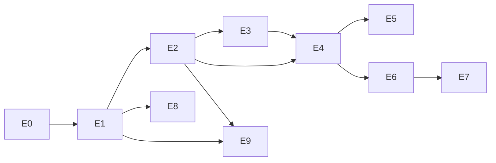

# 名片交换拓展：分阶段执行计划

> 类型：任务实施计划
> 状态：Draft，设计评审前不执行产品实现
> 权威来源：[PRD](./prd.md)、[系统设计](./design.md)、[施工详表](./construction.md)、[验收矩阵](./acceptance.md)、源码研究和当前 package scripts

本轮交付完整规划。下面的 checklist 是未来实施顺序，不是本轮尚须编写的产品代码。当前任务保持 planning；所有产品决定先按系统设计 §18 收敛，再由用户批准对应阶段的最终规划摘要。

2026-10-06 根据当前源码补充了 [施工现况](./research/construction-baseline.md) 与 C00 至 C14 [施工批次](./construction.md)。后者列出文件落点、DDL/backfill 次序、wire 兼容、媒体清理、跨域注销、outbox 和浏览器/设备证据；现存文件与拟新增文件分别标注。各阶段从相应批次执行，不把拆分后的未来 checklist 当已完成实现。

## 1. 交付单元与依赖

建议评审通过后创建以下独立子任务，父任务持有需求追踪和跨阶段集成验收。每个子任务各自写 PRD、design、implement 及 contexts，不能因位于父任务下就自动获得实施授权。

| 单元 | 交付与验收边界 | 依赖 | 发布条件 |
| --- | --- | --- | --- |
| E0 领域与版本基座 | 名片稳定 ID、内容快照、归属与显示状态、媒体引用保留 | D-01；D-12/13/14/15 的模型决定；现有数据对账 | 增量 migration 和旧读模型兼容证明 |
| E1 资料、上传与审核 | 角色资格、企划/组合、署名、AI、旋转/多页、审核 diff、认领/注销 | E0，D-02/03/04/07/10/12/13/14/15 的相应决定 | 上传/审核/认领/媒体 API + Web 闭环 |
| E2 收录与名片册 | 人工/自动申请、单向收录/互换、去重事务、快速组、排序筛选 | E0/E1，D-01/07/08/15 | 两账号 + 并发/失败/解绑/封禁验收 |
| E3 分享与个人公开入口 | 单卡 API、Hono OGP、QR、分享图、主页与已持有角标 | E1/E2，社交分享任务后续授权 | 原始 HTML 与 private/public 权限回归 |
| E4 在线现场会面 | QR 会面、匹配、名单确认、双方滑动、重连补偿 | E2/E3 | Web/App 浏览器闭环与响应丢失重放 |
| E5 临时频道 | QR/四位码、登录加入、成员快照、成对任务与恢复 | E2/E4，D-06 | 容量与枚举防护、部分失败和重启测试 |
| E6 BLE 前台与离线原生 | 共同 BLE/GATT、首次授权/对象核对、设备凭据、签名回执、本地日志及补偿 | E2/E4，D-05/D-09，native spike | 分平台/角色实机验证，无手动网络加入/系统配对，离线只待同步 |
| E7 静默实验 | 独立 opt-in、轮换发现、政策撤销、限额与实际状态；iOS 26 Live Activity 会话单列 | E6，后台跨平台 spike | 每个声称支持组合/后台模式独立通过实机矩阵 |
| E8 特殊工艺与机关表达 | Alpha 预设、静态降级；机关状态图；3D 资源边界研究 | E0/E1，D-10 | 资产安全、性能与视觉一致；3D 单独评审 |
| E9 创作 tag 管理与 i18n | 共享词池、别名与语言名、归并/拆分、规范 ID 筛选与审计 | E0/E1/E2，D-15 | 并发建词、语言冲突、旧 ID 解析与回滚证据 |

E3 的公开分享功能不能只靠本任务建子任务来取消原分享任务的「暂缓」决定；需要整体评审明确恢复的交付范围。E6 的技术 spike 可与 E0/E1 并行做研究，但 E6 写入交换账本前必须依赖 E2 的稳定协议。E7 不作为在线闭环发布前置；所有 NC 要求仍由相应单元覆盖。

## 2. P0：方案收敛与证据冻结

- [ ] 评审 D-01 快照/安全封禁，再按阶段关闭 D-02 至 D-15 的资料、发布、排序筛选、授权批次、保留/认领期限、标签和容量决定。
- [ ] 全量核对 `research/source-map.md` 的路径、当前字段与 pending/claimed/approved 含义，不以同名状态推断同一资格。
- [ ] 对当前 Fudaba、历史来源、owner、图片对象和认领记录做只读统计；数据报告进入被忽略的 `data/migration/`，不写生产数据。
- [ ] 检查新增公开主页的 profile 权限与分享公开投影边界，确认是否恢复已有分享任务后续工作。
- [ ] 在 `packages/contracts/src/paths.ts` 对照现有 route builder 冻结 API suffix/canonical URL，避免路径重命名与目录迁移混在一起。
- [ ] 验证当前 strict owner DTO 的正背/enum/字段限制，冻结新版 wire 入口、旧只读支持范围和最低 App 版本；不能将数据库 expand 当旧客户端支持证明。
- [ ] 确定 native spike 的目标 OS/设备、central/peripheral 能力、首次授权/无系统配对目标和联网/离线语义；按近场与权限研究评审，不假设已安装 BLE/NFC 插件。
- [ ] 建立父子任务映射和逐项 NC 验收；给每个实际实施目标配置非空 implement/check manifests。
- [ ] 展示最新收敛后的 Goal、范围、验收、决定、技术未知及 artifact 状态；取得随后用户消息的明确实施同意才 `task.py start`。

## 3. P1：E0 增量模型、引用与兼容读

目标范围：`apps/api/migrations/`、Fudaba domain、`apps/api/src/ports/repositories/`、`apps/api/src/infra/db/repositories/fudaba-repository.ts`、runtime composition 和现有 `packages/contracts/src/fudaba/` card 模块。具体 handler 文件采用 source-map 的真实路径。

- [ ] 先定义 CardRevision、归属/显示/审核轴、target/credit/page 和 media reference port；保留现有乐观锁 revision 含义。
- [ ] 同阶段建立最小 Tag/Term/CardRevisionTag 表和 canonical resolver 读契约，为 E1 自定义输入/E2 筛选打基础；管理归并与完整多语言编辑留给 E9。
- [ ] E0 按 C01a 版本基座、C01b 最小 tag、C02 引用/旧 FK 分批；C01a 前关闭 D-14，C01b 前关闭影响模型的 D-15，C02 前关闭 D-12/13 的对应约束。
- [ ] 写增量 schema migration 和 PostgreSQL repository 测试，保证 owner 变更、snapshot、CollectionEntry 关联没有危险 cascade。
- [ ] 新旧字段并存期间映射公开/owner/admin 投影，新字段默认值必须保持旧数据安全，不能默认为审核已通过。
- [ ] 新版 metadata/pages/tags/状态契约在新版路径交付，旧 strict 响应不直接加字段；旧写入关闭和不可表示资源的升级结果有 consumer conformance 测试。
- [ ] 旧 `fudaba_exchange_requests` 保留兼容历史；停旧创建/接受写后回填独立 history，评审并取消旧 pending，保留既有终态 trigger。解绑前替换 owner/office-placement 复合 FK，新协议另建 `fudaba_card_exchanges` 等表，accepted 不生成新收藏。
- [ ] 实现 dry-run backfill，报告缺项、归属冲突、图片缺失与重复；写 compare-and-set/事务/幂等覆盖。
- [ ] 媒体读权限及 GC 引用计数先完成，再允许用户解绑；原已公开 URL 撤回边界写入产品文案。
- [ ] 替图、删除、guest TTL 和补偿清理执行端共同检查引用；既有已排队删除也重新验引用。App 复用当前 owner Blob 流程，为 revision/collection/grant 增加独立 API-owned 白名单。
- [ ] 验证同一迁移重复执行无额外版本、数据和对象损失；与现有 legacy 导入/reconciliation 分开操作。

评审门禁：未证明引用存活和旧服务回退安全，不上线解绑/注销扩展。回滚保持增量表及只读新版服务，不执行破坏性 down migration。

## 4. P2：E1 资料、上传、审核与账号生命周期

目标范围：现有 Fudaba card 创建/编辑、media、card-claims、admin 审核能力，Wiki 查询适配、Platform 注销；Web 个人交换工作区、名片详情与认领表单。页面共享视图使用非 route workspace module，遵守现有 App route props 契约。

- [ ] 经管理员审核初始担当资格清单，覆盖四类允许与三类排除；组合展开保留明确成员事实。
- [ ] 增加制作人读法、团体文字、创作署名和自愿 AI；新字段由 contracts 拥有，API 只在请求边界执行 schema。
- [ ] 自定义 tag 通过显式 resolve-or-create 建共享池，原文/概念 ID/locale 分开保存，关联加入内容 hash 和审核 diff；并发去重、禁用词和配额可验证。
- [ ] 正面必填、背面方向提示、逐页旋转、多页上传与重排：服务器校验字节/格式/像素、稳定 pageId 和 optimistic concurrency。
- [ ] 复用对象写入状态机与补偿 port，未审/隐藏资源采用受保护读；派生图读取与本人预览一致。
- [ ] 版本提交、审核 diff、退回理由、锁定编辑禁令、解锁与安全占位统一，禁止疑似 AI 理由。
- [ ] 历史认领保持证据、冲突与管理审核；新上传 owner 从当前身份固定。
- [ ] 墙的新增上传切换为登录上传，历史 guest receipt/status 兼容读取保留；明确匿名访客登录提示，不再让登录用户误走无绑定上传。
- [ ] E1 完成现有账号/会话/card/claim 生命周期、解绑与账号/归属 epoch，保留其他人的合法快照；注销重复请求和失败恢复幂等。新申请、设备、静默模块在 E2/E6/E7 各自启用前接入撤销，E1 不要求这些模块已存在。
- [ ] 按 C04 新建身份域注销能力和生命周期 port，明确二次验证/冻结/事务协调/恢复；当前只有安全子能力，不能假设已有注销接口可挂 callback。
- [ ] 迁移当前 legacy binding/approved claim 的唯一周期与 owner FK，允许经过证明的新绑定；同步 `docs/architecture/platform-account-security.md` 的注销后公开内容政策。
- [ ] 统一 wall/search/count 的认领截止资格；设置截止时需要公告、时区和边界时刻验收。

验收门禁：AC 映射 NC-01 至 NC-16、NC-28 至 NC-32；上传对象失败、退回后重提、并发编辑、锁定和账号删除均有当前 Node/PostgreSQL 证据。

## 5. P3：E2 申请、交易与名片册

- [ ] 新增 exchange/collection/preference contracts、ports、capabilities 和精确 HTTP 错误；先 API 再 endpoint facade 再 UI。
- [ ] E2 同批交付隐藏卡最小 PrivateCardGrant 签发/兑换/撤销、受保护 revision 媒体和参与名单 preflight；覆盖过期/转发/拒绝/非参与方，E3 只复用并接邀请 UI。
- [ ] 新申请/交易/偏好接入 E1 lifecycle/epoch 撤销 fence，补注销与 commit 竞争回归后才开启写入口。
- [ ] 单向 collect 与 mutual 明确 from/to 和获批版本，manual 默认，autoAccept/silent 分开设置。
- [ ] offerDigest 和 consent source 持久化；manual/auto/silent 使用独立授权版本，接受、撤回、超时、重放与版本变化有单一状态机。
- [ ] 固定锁顺序 + 唯一 `(holderAccountId, cardId)` + 全部方向同事务 + outbox；任何路径都不能直接给 CollectionEntry 插行跳过授权。
- [ ] 按 C05 独立交易仓储/runtime 接线；outbox 的 schema、lease/retry/consumer 去重与恢复是本阶段新增施工，不能把 email worker 视为现成通用队列。
- [ ] 名片册按服务端时间与固定排序键查询，企划/角色/组合/团体和多担/越境条件服务端分页；隐藏册项仅影响本人。
- [ ] 增加 canonical tagIds 的 AND/OR 筛选、同卡去重、旧 source ID 解析和 locale 显示，不从 private/draft 名片数生成公共热度。
- [ ] 具体获批隐藏卡授权给收件人/持有者后，可读其 provisional 标签；个人筛选只列本人条目引用词，不能枚举整个非公开池，管理 hidden 始终先于 fallback。
- [ ] 本人排序和快速组支持隐藏卡单次主动授权；组项失效时提示重选，不静默删项。
- [ ] 三入口共享申请与已持有逻辑；前端角标仅作提示，服务端 commit 再检查。
- [ ] CollectionEntry 保留 immutable 获得版本和独立 displayRevisionId；显式更新验证新版本当前公开资格与媒体引用，不能修改获得时间或回执。
- [ ] 完成首次交换后展示 opt-in 引导、申请 inbox 与回执；失败状态不反向报成功。

门禁：NC-15/16/18/19/25/26/27；两个独立登录会话的完整闭环，加并发、回滚、响应丢失、解绑与封禁竞争证据。无需公网或原生硬件即可完成该阶段验证。

## 6. P4：E3 分享交付与 E4 在线会面

分享范围与现有分享任务合并对账，单独保留其已有 Dialog/反应交互回归。

- [ ] contracts paths、`apps/web/app/route-metadata.ts` 和 Hono frontend delivery 同步；新增单卡路由不改列表 Dialog 的上下文。
- [ ] 统一公开投影与资格，公开 HTML/JSON/图每次重验，个人已持有态分离为鉴权查询。
- [ ] Hono GET/HEAD 稳定 head anchor、escaping、canonical、OG/Twitter 标签及缓存元数据契约；加 non-JSON manifest 和 route inventory。
- [ ] 同 canonical URL 的 QR、微信/QQ 预览图、小红书竖图；许可字体与生成预算有打包容器证据。
- [ ] 私有邀请不用公开图；隐藏名片授权登录用户读并不让匿名 OGP 读取。
- [ ] 私有邀请 UI 接入 E2 已交付的收件人绑定 PrivateCardGrant、预收录图和名单 preflight；分享入口回归过期、转发、拒绝和非参与方不可读。
- [ ] 公开主页只出最小获准 profile 与自己公开名片；不公开其 collection。
- [ ] QR 会面匹配、快速组预填、双方滑动/可访问性确认同 digest；断线重新取服务器终态。
- [ ] 本地保存 attempt/exchangeId，任一方重试不重复创建或丢失成功结果。

门禁：NC-17 至 NC-22；原始 HTTP OGP 从 packaged Hono 验证，Web/App-target Playwright 验证页面与路由，第三方原生分享效果如启用则另需设备证据。不能用 Vite 页面 head 或 browser fake 证明 OGP/native。

## 7. P5：E5 临时频道

- [ ] 频道表、成员表、batch 快照与短期代码唯一约束；加入登录、速率/容量与主持策略。
- [ ] joinToken 强随机、token/code 不出日志、Referrer-Policy 与过期处理。
- [ ] 成员变更 invalidates consentSnapshotHash；本人选卡和参与名单可确认。
- [ ] 确认前生成 room-fill 确切项与 pairOfferDigest，允许授权的缺失单方向；全部已持有对 skipped；确认后竞争整对冲突并需两人重新确认。
- [ ] 成对交易计划、bounded worker/outbox、幂等恢复和进度，共用 E2 事务，不在 commit 临时裁剪项。
- [ ] 部分成对失败可重试，不回滚已完成对；新加入成员不自动继承旧授权。
- [ ] 四位代码空间耗尽仍可 QR，缓存失效由 PostgreSQL 恢复；无后台前台查询仍能显示终态。

门禁：NC-23；码冲突、枚举、过期边界、最大容量、成员退出与改卡、worker 重启以及 O(n²) 压力证据。容量超过已验证预算不能只改前端显示上限。

## 8. P6：E6 BLE 前台与离线原生

先进行 native spike 再冻结协议。目标范围是自有 `apps/web/src-tauri/plugins/<owned-plugin>/`、Rust 注册、capabilities、原生源和 TypeScript facade，不编辑 `src-tauri/gen/`。

施工细分为 C10a 设备/角色/权限试验、C10b 联网 BLE 会面 adapter 和 C11 离线双签/补交。C10a 可以先行研究；C10b 写账本依赖 E2/E4；C11 另依赖 D-05 与签名协议评审。GATT 帧的长度/分片/重传/取消均先冻结；默认近场只传会面与授权材料，离线预览使用合法缓存或占位，不将大图传输加入首期。

- [ ] 完整读取 [近场与权限研究](./research/proximity-exchange-and-permissions.md)、平台矩阵和 native 权威 spec；主方案为前台 Core Bluetooth/Android BLE 共同协议，不同时默认接入 Nearby Connections。
- [ ] 逐目标系统探测 BLE scan/advertise/GATT；覆盖 iOS/iOS、Android/Android、iOS/Android 及跨端 central/peripheral 两方向，处理重复发现/双连接，并明确广播缺失机型的支持范围。
- [ ] iOS 自有权限配置添加 NSBluetoothAlwaysUsageDescription；Android 按角色/版本声明并请求权限，评估 neverForLocation。Tauri capabilities、OS 权限、native 生命周期与 facade 一起接线，纯 BLE 不新增 Wi-Fi/本地网络/联系人授权。
- [ ] 用户点击启用近场后首次请求授权；拒绝/限制/蓝牙关闭/硬件缺失分开提示，保留选卡和 QR/线上入口，页面退出或切后台暂停发现，不通过此流程隐式开启 E7。
- [ ] 真机确认无需加入同一 Wi-Fi/热点或系统配对；若 GATT 特征权限触发配对，复核协议/认证和交互目标，不能以删掉应用层认证换取无弹窗。
- [ ] 广告只含最小服务标识，iOS 不依赖任意广告 payload；GATT 交换短期 token、双方 nonce、short-lived server cert、offerDigest 与 canonical signed receipt。
- [ ] 握手后的身份展示接 E4 认证会面/有效离线凭据；多人须选人，同名/歧义时核对绑定会话与 digest 的共同验证码。RSSI 仅辅助候选排序，不能自动同意或承诺厘米级触发。
- [ ] 近场预览/动画/震动绑定真实状态，复用双方滑动及可访问性确认；断网只显示待同步/草稿，在线提交有服务器 committed 才成功。不同已有网络和双方断网分别验收。
- [ ] certificate 注册/撤销、manifest 卡集合、submitBefore、signature 验证和当前资格复查的 HTTP 契约。
- [ ] E6/C11 注册设备凭据和离线日志的注销/解绑撤销处理，验证旧凭据补交与生命周期竞争，再开启 nativeOffline；E1 的 epoch 机制始终是当前资格权威。
- [ ] OS 安全密钥存储和按账号本地日志；原生签名命令不接受任意待签字节/文件路径，限定结构及用途。
- [ ] App 进程重启后日志恢复；任一方上传完整双授权 receipt，都走 E2 的同一原子事务。
- [ ] 并发上传、篡改、重放、过期、凭据撤销、时钟修改、owner 变化和服务器已经完成的分支。
- [ ] NFC 邀请 URL 与 iPhone reader/Android HCE 的 APDU spike 分开记录，包含 NFC 权限、角色和系统读卡界面；不推导为 iPhone/iPhone 支持。UWB、Apple 内容靠近分享、Wi-Fi Aware/Nearby Connections 的资格/交互仅在专项评审后接入，红外仍检查双向硬件；不悄悄替换 transport。

设备入口先运行 `pnpm run app:doctor`，随后按需 `pnpm run app ios --target device` 或 `pnpm run app android --target device`。包装脚本选择目标、profile 和设备；不从新 shell wrapper 直接调用 Tauri CLI。平台权限、签名或设备不可用时记录缺口，不能更改 generated source 绕过。

门禁：NC-20/21/22；前台所有声称支持的平台/角色对、首次/已授权使用、真实系统弹窗、多人/同名对象、握持遮挡、权限撤回/页面退出、双方都无网络、任一方恢复网络、重启日志和服务器冲突均留设备日志/版本/OS/步骤。记录发现/握手/提交延迟与误选/失败分类，再冻结支持范围，不预填虚构成功率。没有完成前台验证不得进入 E7 功能承诺。

## 9. P7：E7 静默实验

- [ ] 独立开关及明确 quick-group/接收限额/有效期，关闭提高 policyRevision 并注销监听。
- [ ] 按官方后台模式验证 iOS 服务过滤/广告限制、Android 后台/前台 service 和权限；不能把后台扫描等同于跨平台互相可发现。
- [ ] 传统 iOS background mode 与 iOS 26 CBManager + Live Activity 分列 spike；后者需验证进入后台前启动、用户可见状态、结束/权限撤回、进程终止和 Android 发现。限时可见会话不能宣传为无感常驻，E6 不依赖它。
- [ ] 锁屏、切后台、force-stop、Doze、重启、权限撤销、低电量/省电模式和系统杀进程分别测试。
- [ ] 记录设备对之间发现率、延迟、耗电和漏交换；不达标平台对明确前台要求。
- [ ] 后台 delegated consent 只覆盖当前 quick-group 和授权版本；关开关后的未完成 receipt 不能自动入册。
- [ ] E7/C12 接入账号注销/归属变更的 policy 撤销与 native 停止处理，竞争回归通过后才开放 silentExperimental。
- [ ] 限制新遇到账号数和同账号频次，无授权路过者只保留瞬时发现 token，不形成历史轨迹。

门禁：NC-24；独立实验发布评审、实际运行状态/停止效果与每个支持平台对的证据。iOS 背景发现或跨平台协议不能成立时，保留完整研究结论和前台替代，不能将实验按钮宣称为普适静默交换。

## 10. P8：E8 特殊展示

- [ ] E1 已支持的异型 contain、多页重排及机关状态图不依赖 GPU/native。
- [ ] Alpha 图层独立资源校验，preset 和 parametersVersion 固定，原图完整 fallback。
- [ ] 静态/减少动态/低性能/列表/OG 表现一致；无效图层不破坏基础名片展示。
- [ ] 模型扩展专项调查 glTF/纹理格式、外部 URI 禁令、资源字节/解码/面数预算、模型转码、离线/缓存、可访问性与无 GPU 降级。
- [ ] 若专项证明成本与安全可接受，再建独立 3D 子任务并审批；机关名片用户可以始终用状态图收录，不需建模。

门禁：NC-30 至 NC-33；视觉与性能用真实资源验证；3D 不作为基本交换功能的硬依赖。

## 11. P9：E9 创作标签管理与多语言

- [ ] 在 E0/E1 已建的 Fudaba card-tags/ports/tables/contracts 上扩展管理归并、别名与 labels，Web 端点镜像，paths/exports/namespace/README 同步。
- [ ] 标签输入、候选和 provisional 激活接入 E1；不从旧 bio/团体/AI 自动生成标签。
- [ ] TagLabel 的 locale、默认语言、fallback 及 labelVersion，所有语言显示仍使用 stable ID。
- [ ] 复用当前固定中文 UI，TagLocalePolicy 与 tag 语言偏好独立；后台多语言预览和 API 显式 locale，不自动放开全站 provider。复用现有 i18n tests 并新增 tag 显示测试。
- [ ] 管理 pool 的筛选、hidden、labels 编辑、merge preview、冲突显式处理、expectedVersions 与 audit。
- [ ] 合并事务按固定锁序，检测 self/cycle/alias conflict，展平 canonical mapping；保留 CardRevisionTag 原文和旧 ID。
- [ ] 合并后的 filters/count/search 重建 outbox 与 live visibility fence；不让旧缓存泄露隐藏词。
- [ ] pool-context 的 active 资格与 private grant/collection resource-context 分开，覆盖首次新词仅在隐藏卡中的授权读取；两者都执行 source/term/root 的管理 hidden 检查。
- [ ] reverse preview/拆分受后续版本限制，不一键覆盖新改动；回滚保留 aliases/mapping 和兼容读。
- [ ] 建词竞争、翻译 fallback、同语言冲突、来源/目标同卡去重、旧过滤 URL、snapshot hash、隐藏绕过与管理权限独立验收。

门禁：NC-34 全部在 tag-design.md/acceptance.md 对应；管理合并开放前所有卡/册/分享/离线消费者能读旧 source ID。

## 12. 验证命令与所有权

下列命令来自当前 scripts/spec/testing 文档，按实际改动范围选择。产品代码完成后子任务还需各自完整质量检查，不能把本轮文档检查当产品验证。

| 范围 | 命令 | 证明范围 |
| --- | --- | --- |
| 本轮任务与上下文 | `python3 .trellis/scripts/task.py validate .trellis/tasks/10-04-namecard-exchange-design` | contexts 引用格式与文件存活；不证明产品决策收敛。 |
| 规则/文档/HTTP 边界 | `pnpm run check:rules` | agent/source rules、non-JSON manifest、inventory、docs metadata/links。 |
| workspace 依赖 | `pnpm run check:boundaries` | workspace import/依赖边界。 |
| contracts | `pnpm --filter @imsweb/contracts run build`；`node scripts/testing/run-test-owner.mjs contracts` | wire exports/schema 和 package 兼容。 |
| API 类型/架构 | `pnpm --filter @imsweb/api run typecheck`；`pnpm --filter @imsweb/api run check:architecture` | 编译和 domain/infra 隔离。 |
| API 服务/持久化 | `pnpm --filter @imsweb/api run test:server`；`pnpm --filter @imsweb/api run test:migration`；必要时 full `test` | Node HTTP、真实 PostgreSQL 的授权/并发/事务/迁移。 |
| Web | `pnpm --filter @imsweb/web run format`；`lint`；`typecheck`；`test:unit` | formatter、静态与组件/endpoint 协议。 |
| 浏览器/壳页面 | `pnpm --filter @imsweb/web run test:e2e`；`test:e2e:app` | UI、路由与降级；不证明 native 射频和后台。 |
| OGP/路由交付 | `pnpm run test:web-routing` | packaged Hono/Web GET/HEAD、资产和路由所有权。 |
| native | `pnpm run app:doctor`；`pnpm run app ios --target device`；`pnpm run app android --target device` | 当前可用设备上的构建/安装/启动，另留硬件协议观察证据。 |
| 跨层最终门禁 | `pnpm run check`；`pnpm run test`，CI full browser lanes | 相关子任务的完整集成回归，按风险范围执行。 |

实施新增 routes 后运行 `node scripts/contracts/compile-route-inventory.mjs --write`，并审查生成差异；新增 HTML/image/stream 的成功边界必须更新 non-JSON manifest。纯规划不改这些产物。

当前工作树三个 API build script 已有独立删除，package scripts 仍引用它们。产品施工前需复查是否已由原改动所有者恢复或调整；本轮不修复。涉及持久化时 PostgreSQL 集成必须实际执行，不能以 `IMS_TEST_POSTGRES_ENABLED=false` 的 pre-commit 结果验收。fixture/catalog 结构测试与新 backfill 数据测试分别记录。

## 13. 发布与回滚记录

每阶段分别留：迁移 dry-run/备份/回读、当前协议与配置版本、开关状态、验收报告和失败分类。生产 `--apply`、签名分发或部署仍遵守现有审批边界，本计划不代替它们。

回滚动作优先关闭对应写入和自动流程，保留已完成名片册与回执读取；对象引用不释放、schema 不 drop、outbox 不删。旧客户端遇到未知协议收到明确版本错误或退回前台 QR。旧服务如果不识别新引用保留规则，不允许直接替换为可能删除已收藏对象的旧实现。

## 14. 本轮设计交付检查

- [x] PRD 完成设计稿结构整理，作为唯一需求/验收来源；NC-01 至 NC-34 无遗漏，推荐参数均标明待确认。
- [x] design/acceptance/implement 与当前 Fudaba、Platform、媒体和分享边界一致。
- [x] research 有代码锚点和官方平台来源，规划与现状不混写。
- [x] implement/check manifests 引用真实 spec 与 research。
- [x] task validate、规则/边界检查和本任务所有相对链接检查有实际证据。
- [x] 完整设计评审稿与下一产品决定已形成；任务保持 planning，未因 goal 模式直接启动实现。
- [x] 本次近场调研补入前台 BLE 权限/共同协议、替代技术、iOS 26 后台版本差异与真机交互验收；产品实施 checklist 仍未执行。
- [x] 根据当前源码补充 C00 至 C14 施工详表，明确媒体已排队清理、严格旧 DTO、身份注销新能力、独立 outbox、现存测试入口与阶段依赖。

上述为设计交付验收；D-01 至 D-15 的产品收敛及用户批准最新实施摘要仍是后续门禁。各产品实施阶段 checklist 保持未执行。
